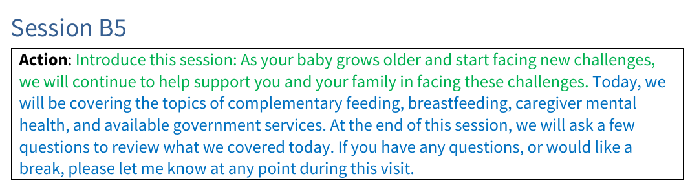
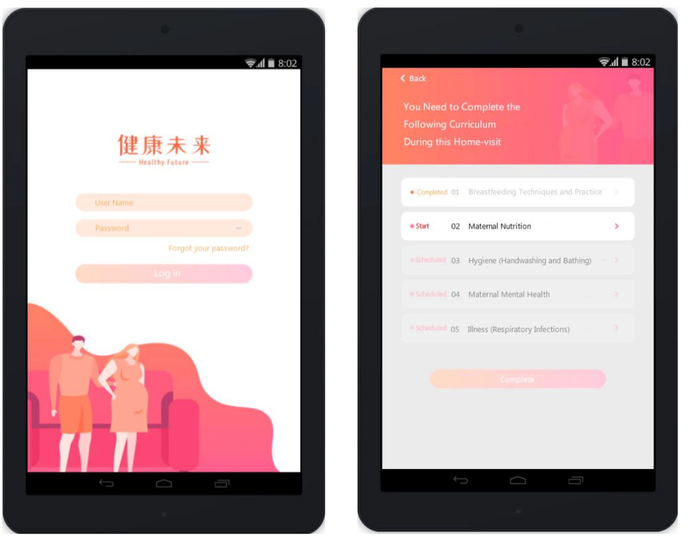

## The content allocation problem {#content-allocation data-timing="60"}

::: {.lead}
More useful content must fit within limited visit time and family attention.
:::

::: {.accent-line}
Families at the same stage may ask for different support
:::

:::: {.columns .family-examples}
::: {.column width="48%"}
### One caregiver

Wants to revisit complementary feeding and practical feeding questions.
:::
::: {.column width="48%"}
### Another caregiver

Feels confident about feeding, but wants more support with stress.
:::
::::

::: {.caption}
Illustrative examples. Which content should get priority in the next visit?
:::

::: {.notes}
[60 seconds] More topics compete for limited visit time and caregiver attention. Stage matching helps with timing, while families at the same stage can have different questions and preferences. The examples are hypothetical. The current curriculum already contains questions and branches; tailoring is a question of content allocation within a shared delivery process.

Sources: [Belgium talk, March 28, 2026](https://github.com/sysylvia/presentations/blob/main/research/2026-03-reap-belgium-hf/slides.qmd); [trial protocol](https://doi.org/10.1136/bmjopen-2022-065403).
:::

## A practical curriculum for the home visit {#curriculum data-timing="65"}

::: {.lead}
26 sessions, from month 4 of pregnancy through 18 months after birth
:::

Scripts, discussion prompts and knowledge checks support consistent delivery.

{.curriculum-excerpt fig-alt="Session B5 introduction from the September 2025 English curriculum, printed page 151."}

::: {.caption}
Curriculum excerpt, printed p.151. © 2022 Stanford University. CC BY-NC 4.0.
:::

::: {.notes}
[65 seconds] The actual session introduction makes the curriculum concrete. It helps the CHW introduce the visit and set expectations. Sessions combine topics and reinforce earlier content. Reuse follows the existing license; cultural adaptation and clinical review remain necessary in another setting.

Source: [Healthy Future Curriculum, English September 2025 edition](https://dhep.org/files/healthy-future/healthy-future-curriculum-2025-09.pdf), printed p.151 / PDF p.153. Healthy Future Program © 2022 Stanford University, CC BY-NC 4.0.
:::

## The China cluster-randomized trial {#trial data-timing="60"}

::: {.lead}
119 townships in four Sichuan counties
:::

| Assignment | Townships | Comparison |
|:---|:---|:---|
| Healthy Future | 40 | CHW visits + curriculum + digital support |
| Control | 79 | No Healthy Future intervention |

::: {.study-cohort}
1,306 families in the analysis cohort 
Pregnant women or caregivers of infants under 6 months at baseline
:::

::: {.caption}
12-month intervention. Intent-to-treat analysis. Results are a preprint.
:::

::: {.notes}
[60 seconds] Township randomization was stratified by county. The protocol specified two intervention variants with 20 townships each and 79 controls. The main analysis pools the 40 intervention townships. The analysis cohort is 1,306; outcome-specific samples differ. COVID restrictions consolidated follow-up waves and reduced the younger-infant sample.

Sources: [protocol](https://doi.org/10.1136/bmjopen-2022-065403); [Chen et al., medRxiv v2, June 16, 2026](https://www.medrxiv.org/content/10.64898/2026.03.27.26349570v2.full.pdf), methods and Tables 3–4.
:::

## Primary outcomes: modest dietary-diversity gain {#primary-outcomes data-timing="90"}



::: {.caption}
Points: ITT estimates. Lines: 95% confidence intervals. Different units and scales. 
Chen et al., 2026 preprint v2, Table 3
:::

::: {.notes}
[90 seconds] Read each outcome in its own units. The dietary-diversity estimate is 0.207 food groups, with the 95% interval just above zero. Hemoglobin and exclusive breastfeeding have intervals spanning zero. Breastfeeding has a wide interval and 210 age-eligible observations. Neither estimate establishes zero effect. The panels have different horizontal scales.

Source: [evaluation preprint v2](https://www.medrxiv.org/content/10.64898/2026.03.27.26349570v2.full.pdf), Table 3. Probability differences and interval endpoints for breastfeeding are multiplied by 100 to display percentage points. No participant-level reanalysis.
:::

## Exploratory evidence on family targeting {#heterogeneity data-timing="65"}

::: {.lead}
The screening asked who benefits more from the whole package.
:::

| Whole-program screening | Interpretation |
|:---|:---|
| Most screened outcomes: no clear signal | No dependable family-targeting rule established |
| Mental health: suggestive signal | A hypothesis requiring further validation |

::: {.takeaway}
It did not test which module works best for each family.
:::

::: {.caption}
Nondetection does not prove equal effects. This is exploratory evidence. 
Healthy Future exploratory analysis, March 2026
:::

::: {.notes}
[65 seconds] Causal forests screened whether effects of the complete intervention varied across measured family characteristics. The later Belgium talk reports limited clear evidence across the exploratory screen and a suggestive mental-health signal. Nondetection does not establish equal effects, and the screen does not establish a validated targeting policy. A whole-program trial does not identify module-specific effects. The summary stays qualitative because numerical outcome labels differ between the prior talk's main and appendix tables.

Sources: [Belgium presentation](https://github.com/sysylvia/presentations/blob/main/research/2026-03-reap-belgium-hf/slides.qmd); [grf calibration guidance](https://grf-labs.github.io/grf/reference/test_calibration.html).
:::

## The backend separates content from delivery {#backend data-timing="85"}

::: {.lead}
A structured curriculum can change without rewriting the visit screen.
:::



::: {.caption}
The shared content model provides a base for evaluating new allocation rules.
:::

::: {.notes}
[85 seconds] Program managers configure curricula. The Spring Boot API exposes scheduling and content; MySQL stores curriculum and visit records; the Android app renders configured visits and returns completion and responses. A curriculum contains lessons, which reference topic modules, which contain structured components. This describes implemented responsibilities, not an automatic PDF importer or a learned recommendation policy.

Source: [CareLoom, inspected source revision](https://github.com/DHEPLab/careloom/tree/71468fae6ce0ca9cd434ebbf847f7eac30cee11e). Relevant API classes: Curriculum, Lesson, Module, LessonSchedule, Component and LessonService; app module rendering in `utils/module.ts` and `screens/Module.jsx`.
:::

## Curriculum structure enables different paths {#branching data-timing="85"}

::: {.lead}
Today: stage, age and prior visits select the next lesson.
:::



::: {.caption}
Configured branching exists today. Learned module prioritization remains proposed.
:::

::: {.notes}
[85 seconds] A lesson is a visit session referencing topic modules. Modules contain text, media and branching questions. Scheduling uses curriculum assignment, stage, age and prior lesson coverage. The CHW can select a case based on a caregiver's response; configured content and continue/redirect actions change the path. The example is illustrative. Automatic learning of which module to prioritize remains a proposal. MASTER/DRAFT in the source refers to editing branches, not family-tailoring branches.

Sources: [CareLoom source](https://github.com/DHEPLab/careloom/tree/71468fae6ce0ca9cd434ebbf847f7eac30cee11e); [curriculum](https://dhep.org/files/healthy-future/healthy-future-curriculum-2025-09.pdf).
:::

## Testing which content to prioritize {#future-work data-timing="80"}

::: {.lead}
Same curriculum and delivery platform, different allocation rules
:::

| Approach | How content gets priority |
|:---|:---|
| Stage-based delivery | The current developmental schedule |
| Family choice | Caregivers select from eligible topics |
| Algorithmic prioritization | Family context, visit history and predicted benefit |

::: {.accent-line}
Proposed evaluation: outcomes, engagement, fidelity and CHW workload.
:::

::: {.notes}
[80 seconds] These proposed comparisons share a curriculum and delivery infrastructure but change content allocation. The whole-program RCT cannot estimate the benefit of these alternatives or the effect of each module. A future study needs a prespecified comparison, outcomes and process measures. Improvements in outcomes or workload are research questions, not established capabilities or commitments.

Source: [Belgium talk](https://github.com/sysylvia/presentations/blob/main/research/2026-03-reap-belgium-hf/slides.qmd); [CareLoom](https://github.com/DHEPLab/careloom).
:::

## Resources for adaptation and research {#resources data-timing="70"}

::: {.resource-link}
[dhep.org/healthy-future](https://dhep.org/healthy-future/)
:::

| Resource | Available material | Reuse terms |
|:---|:---|:---|
| Curriculum | English PDF, September 2025 | CC BY-NC 4.0 |
| CareLoom | Public source repository | Apache 2.0 |
| Implementation | Program and developer guides | Repository documentation |

Local adaptation, hosting and implementation support still matter.

::: {.caption}
Public source available. Packaged release acceptance remains pending.
:::

::: {.notes}
[70 seconds] Point to the existing resource page. Software and curriculum use different licenses. Public source and guides are available; deployment still requires implementation work. Source availability does not imply a packaged public release or readiness in a new setting.

Sources: [project page](https://dhep.org/healthy-future/); [CareLoom repository and Apache 2.0 license](https://github.com/DHEPLab/careloom); [curriculum and CC BY-NC 4.0 terms](https://dhep.org/files/healthy-future/healthy-future-curriculum-2025-09.pdf). Resource status checked November 13, 2026; GitHub lists no releases at that check.
:::

## A platform for testing responsive home visits {#closing data-timing="35"}

::: {.closing-question}
Which content choices would you test within a shared home-visiting platform?
:::

::: {.resource-link}
[dhep.org/healthy-future](https://dhep.org/healthy-future/)
:::

::: {.credits}
Stanford REAP, Sichuan University, UNR and UNC Chapel Hill 
With thanks to participating families and community health workers
:::

::: {.caption}
Enlight Foundation and private donors; Healthy Future 2.0: Cyrus Tang Foundation
:::

::: {.notes}
[35 seconds] Close with the question colleagues could study using an adaptable curriculum and shared delivery infrastructure. The current trial supports specific findings; new settings and tailoring policies need their own evaluation. Thank families, CHWs, collaborators and funders. This is the end of the 12-minute main route; the remaining slides are backup.

Sources: [protocol](https://doi.org/10.1136/bmjopen-2022-065403); [project page](https://dhep.org/healthy-future/).
:::

## Backup: selected secondary outcomes {#backup-secondary .backup data-timing="0"}



::: {.caption}
Lower is better for these outcomes. FDR-adjusted p ≤ 0.036 within domains. 
Preprint estimates. Child illness N = 1,148; caregiver symptoms N = 973. 
Chen et al., 2026 preprint v2, Table 4
:::

::: {.notes}
[Backup] Selected secondary outcomes from Table 4 do not replace the primary outcomes. The four shown retain FDR-adjusted p-values below .05 within their domains. Mental-health measures are symptoms or screening classifications, not clinical diagnoses. Effects concern the integrated intervention, not the software alone.

Source: [preprint v2](https://www.medrxiv.org/content/10.64898/2026.03.27.26349570v2.full.pdf), Table 4. Binary estimates and intervals are displayed in percentage points.
:::

## Backup: primary-outcome estimates {#backup-primary .backup data-timing="0"}

| Outcome / unit | ITT [95% CI] | N observed | p |
|:---|:---|:---|:---|
| Hemoglobin, g/L | −0.382 [−1.964, 1.200] | 904 | 0.636 |
| Exclusive BF, probability | 0.057 [−0.060, 0.174] | 210 | 0.341 |
| Dietary diversity, food groups | 0.207 [0.015, 0.399] | 938 | 0.035 |

County fixed effects and post-double-selection LASSO covariates. 
Standard errors clustered by township. Nominal p-values for primary outcomes.

::: {.caption}
Chen et al., medRxiv v2 (June 16, 2026), Table 3. Not peer reviewed.
:::

::: {.notes}
[Backup] Main-slide breastfeeding results convert probability units to percentage points. Hemoglobin IPW sensitivity: −0.346 g/L, 95% CI −1.919 to 1.228. No new participant-level analysis was performed.

Source: [preprint v2](https://www.medrxiv.org/content/10.64898/2026.03.27.26349570v2.full.pdf), Table 3.
:::

## Backup: interpreting the exploratory screen {#backup-heterogeneity .backup data-timing="0"}

| Question | What this evidence can support |
|:---|:---|
| Do whole-program effects vary by family? | Exploratory causal-forest screening |
| Which module helps a particular family? | Not identified by a bundled-intervention trial |
| Does a new prioritization policy improve outcomes? | Requires a separate evaluation |

No clear signal is not proof of equal effects. 
Predicted effect variation is not a validated targeting gain.

::: {.notes}
[Backup] The exploratory screen used causal forests with baseline family characteristics and township clustering. Multiple nominal screens are not confirmatory evidence. Numerical labels differ across the prior talk's main and appendix tables, so this deck does not report their exact p-values. A spread of predicted CATEs does not establish a useful allocation policy. Whole-package effects cannot identify component effects.

Sources: [Belgium talk](https://github.com/sysylvia/presentations/blob/main/research/2026-03-reap-belgium-hf/slides.qmd); [grf calibration](https://grf-labs.github.io/grf/reference/test_calibration.html); [RATE guidance](https://grf-labs.github.io/grf/reference/rank_average_treatment_effect.html).
:::

## Backup: interpretation and design limits {#backup-limits .backup data-timing="0"}

| | |
|:---|:---|
| **Bundled intervention** | The trial does not isolate app effects. |
| **Age-specific follow-up** | COVID restrictions reduced the younger-infant sample. |
| **Exploratory analyses** | Post-hoc domain indices and entry timing require separate interpretation. |
| **Transfer to new settings** | Adaptation and a new evaluation remain necessary. |

::: {.notes}
[Backup] The intervention variants were randomized, but the main analysis pools them. COVID disrupted follow-up and age-specific availability. Domain indices were post hoc. Prediction and entry timing do not establish mediation or a validated surrogate. Results in rural Sichuan do not establish transferability.

Sources: [preprint v2](https://www.medrxiv.org/content/10.64898/2026.03.27.26349570v2.full.pdf); [protocol](https://doi.org/10.1136/bmjopen-2022-065403).
:::

## Backup: collaborators and sources {#backup-sources .backup data-timing="0"}

### Trial team

Yunwei Chen, Yuju Wu, Ann M. Weber, Alexis Medina, Yian Guo, 
Siva Balakrishnan, Hanwen Zhang, Scott Rozelle, Huan Zhou, 
Gary L. Darmstadt and Sean Sylvia

::: {.source-links}
[Evaluation preprint, version 2 (June 2026)](https://www.medrxiv.org/content/10.64898/2026.03.27.26349570v2) 
[Published trial protocol, BMJ Open (2023)](https://doi.org/10.1136/bmjopen-2022-065403) 
[Curriculum and guides: dhep.org/healthy-future](https://dhep.org/healthy-future/) 
[Public source: github.com/DHEPLab/careloom](https://github.com/DHEPLab/careloom)
:::

::: {.notes}
[Backup] Author order follows the preprint. The public project page identifies implementation partners and funders. Existing resource links do not announce a new software release.
:::

## Backup: the CareLoom interface {#backup-interface .backup data-timing="0"}

:::: {.columns}
::: {.column width="45%"}
### Program manager
Configure curriculum and stages

### Community health worker
Schedule visits and deliver modules

### Supervisor
Review visit completion and reports
:::
::: {.column width="52%"}
{.interface-image fig-alt="Public CareLoom login and visit-module screens, with no participant records."}

::: {.caption}
Public interface example, DHEPLab / CareLoom
:::
:::
::::

::: {.notes}
[Backup] This public interface example illustrates program administration, CHW visits and supervision. It is not a live deployment or evidence of current production readiness. Android app, web administration and API responsibilities are distinct.

Sources: [CareLoom](https://github.com/DHEPLab/careloom); [public screenshot](https://dhep.org/images/healthy-future-chw-app-screenshot.webp).
:::
