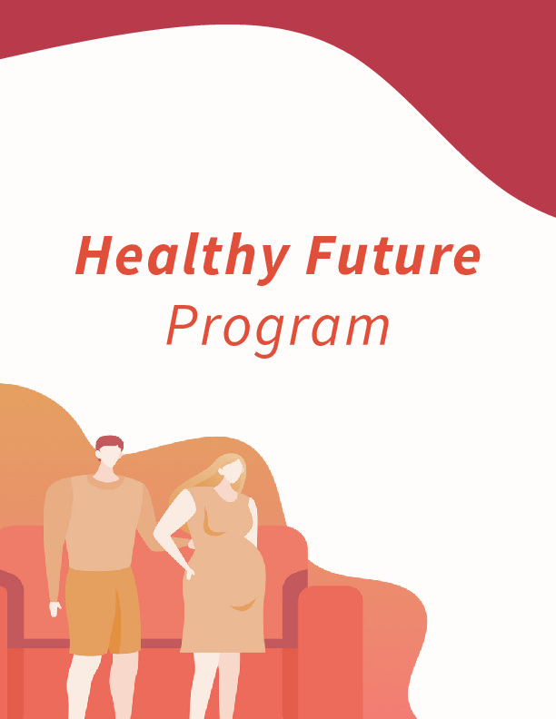
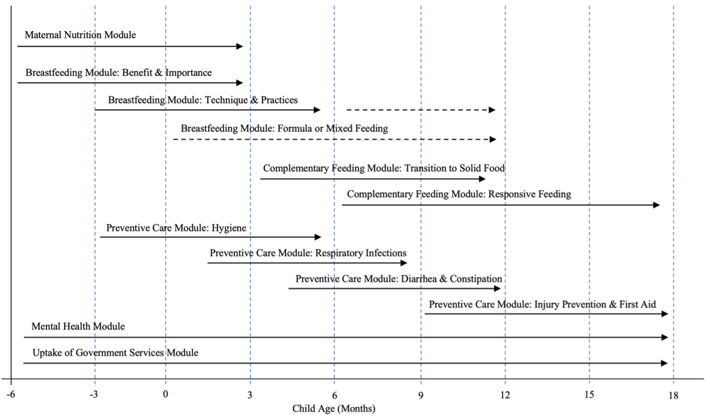

## Healthy Future collaborators {#collaborators data-timing="25"}

::: {.collaborators-grid}
::: {.institution}
{.institution-logo fig-alt="Stanford University logo"}

### Stanford University

Yunwei Chen · Gary L. Darmstadt 
Alexis Medina · Scott Rozelle 
Yian Guo · Hanwen Zhang 
Sarah-Eve Dill
:::
::: {.institution}
::: {.scu-logo-band}
{.institution-logo fig-alt="Sichuan University official wordmark"}
:::

### Sichuan University

West China School of Public Health 
Yuju Wu · Huan Zhou
:::
::: {.institution}
{.institution-logo fig-alt="University of North Carolina at Chapel Hill official signature"}

### UNC Chapel Hill

Sean Sylvia 
Christopher M. Westgard
:::
::: {.institution}
{.institution-logo fig-alt="University of Nevada Reno logo"}

### University of Nevada, Reno

Ann M. Weber · Siva Balakrishnan 
Sarah A. Friedman · Joshua V. Garn
:::
:::

::: {.source-note}
Collaborators across the Healthy Future protocol and published studies. [Project and affiliations](https://dhep.org/healthy-future/).
:::

::: {.notes}
[25 seconds] Healthy Future is a collaboration across these institutions, local health systems and participating families. Credits combine contributors to the protocol and published Healthy Future studies, not just one paper. Institutional groupings follow the public project credits. Thank the implementation teams and families verbally.
Source: https://dhep.org/healthy-future/ (collaborators and linked publications; checked November 13, 2026).
:::

## Home visits: global reach, demanding delivery {#global-evidence data-timing="65"}

:::: {.columns}
::: {.column width="46%"}

### Importance and reach

::: {.big-stat}
≈4 million
community health workers
:::
Reported by **93 countries** 
WHO national health workforce accounts, 2024

::: {.impact-stat}
**12% lower neonatal mortality** 
95% CI: 5–18% lower
:::
Pooled home-visit trials in programme settings in South Asia and sub-Saharan Africa (2013).
:::
::: {.column .fragment width="50%" data-fragment-index="0"}

### Delivery challenges

- Maintaining implementation fidelity
- Training and supervision require time and expertise
- Broad workloads and reporting demands

::: {.priority-problem}
**One-size-fits-all content** 
The same stage does not imply the same needs.
:::
::: {.priority-problem}
**Limited data-driven prioritization** 
Which content is most valuable for this family?
:::
:::
::::

::: {.source-note}
[WHO, EB156/15, §9 (2024)](https://apps.who.int/gb/ebwha/pdf_files/EB156/B156_15-en.pdf) · [Kirkwood et al., Lancet (2013)](https://doi.org/10.1016/S0140-6736(13)60095-1) · [WHO CHW guideline (2018)](https://www.who.int/publications/i/item/9789241550369)
:::

::: {.notes}
[65 seconds] First show importance and reach. Advance once to reveal the delivery-challenges column. CHWs are a large global workforce; the four-million figure is reporting from 93 countries, not a census of home visitors. The home-visit estimate is a historical pooled effect on neonatal mortality in programme-setting trials in South Asia and sub-Saharan Africa, not a prediction for every programme or for Healthy Future. WHO identifies training, supervision, quality and workload as implementation needs. The two highlighted content-allocation problems motivate our work: our stage-based system does not yet provide validated outcome-informed personalization. Do not describe all CHW programmes as uniformly one-size-fits-all or without data.
Sources: WHO EB156/15 (20 December 2024), §9; Kirkwood et al. 2013, doi:10.1016/S0140-6736(13)60095-1, pooled programme-setting estimate; WHO 2018 CHW guideline, selection/training, supportive supervision, workload and data recommendations.
:::

## The Problem: One Visit, Many Needs {#content-allocation data-timing="45"}

:::: {.columns}
::: {.column width="56%"}
A maternal and child health home visit may need to cover:

- **Breastfeeding** — initiation, exclusivity, timing
- **Complementary feeding** — diversity, frequency
- **Maternal mental health** — depression, anxiety, stress
- **Health service uptake** — vaccines, checkups
- **Sanitation and safety**
- **Stimulation** — responsive caregiving, early learning
- **And more…**
:::
::: {.column width="39%"}
::: {.callout-important}

### The standard approach

Families at the same developmental stage receive the same scheduled content, despite different needs and circumstances.
:::

**The constraint:** limited visit time and caregiver attention.
:::
::::

::: {.notes}
[45 seconds] A broad maternal and child health agenda competes for one visit. Responsive caregiving is part of the broader agenda, not a claim that the original Healthy Future trial tested a separate stimulation intervention. For Healthy Future, stage determines scheduled content; families at that stage still differ. Transition to the integrated programme.
:::

## The Healthy Future Program {#program data-timing="45"}

:::: {.columns}
::: {.column width="68%"}
A digitally supported programme for mothers and children, from pregnancy through **18 months after birth**.

### Three connected components

- **Stage-based curriculum** — 26 sessions across six content domains
- **CHW home visits** — structured delivery by trained local health workers
- **Digital platform** — content assignment, scheduling and monitoring
:::
::: {.column width="27%"}
{.curriculum-cover fig-alt="Original Healthy Future curriculum cover"}
:::
::::

::: {.source-note}
[Trial protocol](https://doi.org/10.1136/bmjopen-2022-065403) · [English curriculum, September 2025](https://dhep.org/files/healthy-future/healthy-future-curriculum-2025-09.pdf)
:::

::: {.notes}
[45 seconds] The intervention combines content, people and software. It addresses maternal and child health through stage-matched home visits. The curriculum starts in month four of pregnancy; the full curriculum extends to 18 months after birth. The trial delivered the programme over a 12-month study period; those are different time spans.
:::

## Healthy Future home-visit demo {#demo data-timing="70"}

<video data-external="1" class="demo-video" src="assets/healthy-future-demo.mp4" poster="assets/demo-poster.png" controls preload="metadata" playsinline title="Healthy Future home-visit demo"></video>

::: {.video-link}
[**Open full video ↗**](https://canva.link/otaxx4z8kq8086z){target="_blank" rel="noopener"}
:::

::: {.notes}
[70 seconds, including approximately 60 seconds of video] Show the app guiding a home visit, presenting content and capturing responses. Use the direct link if network access or the embedded player fails. The video is an existing programme demonstration, not new trial evidence. Stop after about one minute to preserve timing.
Source: original Healthy Future Video shared in the Belgium talk. The existing public demo is embedded as a native video; the original Canva link remains available.
:::

## What CHWs deliver: a stage-based curriculum {#curriculum data-timing="45"}

::: {.curriculum-lead}
**26 sessions · Six domains · Pregnancy to 18 months after birth**
:::

{.curriculum-timeline fig-alt="Original Healthy Future module timeline: maternal nutrition, breastfeeding, complementary feeding, preventive care, mental health and government-service uptake, by child age"}

::: {.source-note}
Original programme timeline, reused from the Belgium talk. [Curriculum](https://dhep.org/files/healthy-future/healthy-future-curriculum-2025-09.pdf): © 2022 Stanford University, CC BY-NC 4.0.
:::

::: {.notes}
[45 seconds] Walk through how topics change over pregnancy and infancy. Mental-health and government-service content recur across stages. This is scheduled content coverage, not evidence that every component has a known causal effect for every family. In the trial, 82% of intervention families received at least one visit; participating families had a median 12 visits and median visit duration 32 minutes. The numerical implementation details are in notes to keep the timeline readable.
Sources: Healthy Future curriculum (English September 2025); Chen et al., medRxiv v2 and September 2026 manuscript, Table 2.
:::

## The Healthy Future Platform {#platform data-timing="50"}

:::: {.columns}
::: {.column width="49%"}

### CHW-facing Android app

- Stage-matched visit content
- Scripts, media and structured questions
- Visit completion and response capture
- Offline work after initial setup and content preparation

### Supervisor-facing dashboard

- Curriculum authoring and publishing
- CHW and visit management
- Visit monitoring and reporting
:::
::: {.column width="46%"}
{.platform-screenshot fig-alt="Public CareLoom screenshot showing the English login and curriculum-module screens"}

::: {.callout-note}
**Separate content and delivery** 
The app renders the configured curriculum. 
English and Chinese interfaces.
:::
:::
::::

::: {.source-note}
[CareLoom source and documentation](https://github.com/DHEPLab/careloom) · [Public platform overview](https://dhep.org/healthy-future/)
:::

::: {.notes}
[50 seconds] This is CareLoom, the platform behind Healthy Future. Describe implemented functions without claiming demonstrated reductions in CHW workload or automatically learned recommendations. Initial login, synchronization and media preparation require connectivity; offline support is qualified accordingly. English and Chinese are supported; other languages and outcome-informed recommendations remain development work. Public screenshot contains no participant records.
:::

## Open Source and Extensible {#open-source data-timing="35"}

:::: {.columns}
::: {.column width="48%"}

### CareLoom platform

**Apache License 2.0**

Reusable delivery infrastructure for structured modular curricula.

[github.com/DHEPLab/careloom](https://github.com/DHEPLab/careloom)
:::
::: {.column width="48%"}

### Healthy Future curriculum

**CC BY-NC 4.0**

English PDF with scripts, activities and knowledge checks. Adapt with attribution for non-commercial use.

[Curriculum and setup guides](https://dhep.org/healthy-future/)
:::
::::

::: {.funding-thanks}
Thank you to the **Carolina Population Center** for seed funding supporting open-sourcing and English-language access.
:::

::: {.source-note}
Public source and guides are available. No packaged software release.
:::

::: {.notes}
[35 seconds] Invite reuse while distinguishing software from curriculum licensing. CPC seed funding supported opening the infrastructure and English-language access. The November 13 implementation and documentation updates are merged to main; this deck links current public material. No installable packaged release is claimed.
Sources: CareLoom LICENSE; curriculum attribution page; Sean Sylvia CV, 2024–25 CPC award “Open Sourcing a Maternal and Child Health Home Visiting Platform Called Healthy Future”; https://dhep.org/healthy-future/.
:::

## The initial China randomized trial {#trial data-timing="95"}

::: {.trial-design}
**119 townships · 4 Sichuan counties** → **40 intervention / 79 control** → **1,306 families · 12 months**
:::

::: {.trial-population}
Pregnant women or caregivers of infants under 6 months at baseline · County-stratified township randomization
:::



::: {.source-note}
ITT effects with 95% CIs; primary outcomes and selected secondary outcomes. [Chen et al., medRxiv v2 (June 2026), Tables 3–4](https://www.medrxiv.org/content/10.64898/2026.03.27.26349570v2.full.pdf). The integrated programme was evaluated, not the app alone.
:::

::: {.notes}
[95 seconds] Township randomization was stratified by county. Two intervention variants, 20 townships each, are pooled here versus 79 controls. The analysis cohort is 1,306; outcome-specific samples differ. The intervention lasted 12 months. The primary dietary-diversity estimate is modest and positive; hemoglobin and exclusive breastfeeding intervals include zero. Selected secondary outcomes show lower reported child illness and caregiver symptoms. These are selected secondary results with multiplicity-adjusted p-values in source Table 4, not an exhaustive list. Each primary row has its own labeled unit/scale; secondary effects are percentage points. Lines show 95% confidence intervals. Results are a preprint; the later recovered manuscript agrees on these values. Do not infer component-specific effects or validated personalization gains.
Sources: trial protocol doi:10.1136/bmjopen-2022-065403; Chen et al., medRxiv v2, Tables 3–4.
:::

## The backend separates content from delivery {#backend data-timing="55"}

::: {.backend-lead}
**The app is reusable. The curriculum is separately defined.**
:::



::: {.accent-statement}
Add another modular curriculum through the same content structure.
:::

::: {.notes}
[55 seconds] Emphasize app versus curriculum: Healthy Future is one curriculum running on a more general delivery platform. Lessons describe stage/age windows and reference topic modules; modules contain scripts, media and structured components. The app renders that configuration. Another curriculum must be structured in the supported model; there is no automatic arbitrary-PDF importer. Explain branching verbally: a configured question can send a family through different content paths. Those authored branches are distinct from learned outcome prioritization.
Sources: CareLoom entities Curriculum, Lesson, Module, Component and LessonService; inspected public revision 71468fae6ce0ca9cd434ebbf847f7eac30cee11e; https://github.com/DHEPLab/careloom.
:::

## Next phase of research {#next-phase data-timing="55"}

::: {.funding-line}
Supported by the **Cyrus Tang Foundation** 
Stanford prime award · UNC subaward
:::

::: {.research-question}
For this family, which content should receive priority to improve the target outcomes?
:::

::: {.model-flow}
Family context + visit history → Predict benefit by topic → Prioritize content
:::

::: {.callout-note}
### Research Objective

Develop and evaluate predictive models for family-specific content allocation.
:::

::: {.source-note}
[Healthy Future 2.0 funding and project overview](https://dhep.org/healthy-future/). Model development is distinct from demonstrated impact.
:::

::: {.notes}
[55 seconds] Name the Cyrus Tang Foundation, as listed on the public project page. The funded next phase aims to develop predictive models to prioritize the content expected to help an individual family with specified outcomes. Predictive association alone does not establish a causal gain from reallocating modules. The model and allocation rule require prospective evaluation. Do not announce trial recruitment or imply the award scope includes every proposed evaluation. No award amount or dates are added.
Source: public Healthy Future funder listing and HF 2.0 overview; model-development focus specified by Sean for this talk.
:::

## Testing which content to prioritize {#future-work data-timing="70"}

::: {.trial-lead}
Same curriculum and platform. Three allocation approaches.
:::

| Stage-based delivery | Family choice | Algorithmic prioritization |
|:---|:---|:---|
| Content follows the developmental schedule | Caregivers choose from eligible topics | Content ranked by predicted benefit for the family and target outcomes |

::: {.trial-comparison}
Proposed trial comparison
:::

**Assess:** health outcomes · engagement · fidelity · CHW workload

::: {.source-note}
Future research plan, adapted from the Belgium presentation. These comparisons have not yet established a personalization benefit.
:::

::: {.notes}
[70 seconds] The planned comparison changes the rule for allocating content while keeping delivery infrastructure and curriculum shared. Compare the stage-based benchmark with family choice and algorithmic prioritization. Prespecify outcomes, eligibility, fidelity and workload measures. The previous whole-program trial does not tell us which module to allocate to which family. This is the proposed future trial, not completed results or a commitment on recruitment date, sample size or finalized protocol.
Source: Belgium talk, Healthy Future 2.0 planning and Sean's requested next-phase comparison.
:::

## Reuse, adapt and contribute {#resources .closing-slide data-timing="45"}

::: {.closing-url}
[**dhep.org/healthy-future**](https://dhep.org/healthy-future/)
:::

:::: {.columns}
::: {.column width="46%"}

### Stage-based curriculum

| Stage | Example content |
|:---|:---|
| Pregnancy | Maternal nutrition; breastfeeding preparation |
| Birth–6 months | Breastfeeding; hygiene and infant health |
| 6–18 months | Complementary feeding; illness and injury prevention |
| Across stages | Mental health; government-service uptake |

[English curriculum PDF](https://dhep.org/files/healthy-future/healthy-future-curriculum-2025-09.pdf) · CC BY-NC 4.0
:::
::: {.column width="49%"}

### CareLoom and documentation

[**Repository ↗**](https://github.com/DHEPLab/careloom) · Apache-2.0 
[Implementer guide](https://github.com/DHEPLab/careloom/blob/main/docs/implementer-guide/README.md) · [Developer guide](https://github.com/DHEPLab/careloom/blob/main/docs/developer-guide/README.md) 
[Contributing](https://github.com/DHEPLab/careloom/blob/main/CONTRIBUTING.md)

### Get in touch

**Sean Sylvia:** [sean.sylvia@unc.edu](mailto:sean.sylvia@unc.edu) 
**DHEPLab:** [dheplab@unc.edu](mailto:dheplab@unc.edu)
:::
::::

::: {.contribute-invitation}
We welcome contributions, questions, adaptations and ideas for new features.
:::

::: {.notes}
[45 seconds] Close with one place to start: the existing project website. The compact table summarizes recurring content, not an exhaustive session-by-session schedule. The PDF and software have different licenses. Both source and guides are public; the November 13 source/docs updates are merged, while no packaged release or hosted runtime is announced. Invite researchers, implementers and developers to contact Sean or the lab. Offer participation in adaptation and evaluation rather than promising implementation support.
Sources: https://dhep.org/healthy-future/; https://dhep.org/contact/; CareLoom LICENSE, guides and contributing instructions; Healthy Future curriculum, September 2025.
:::
